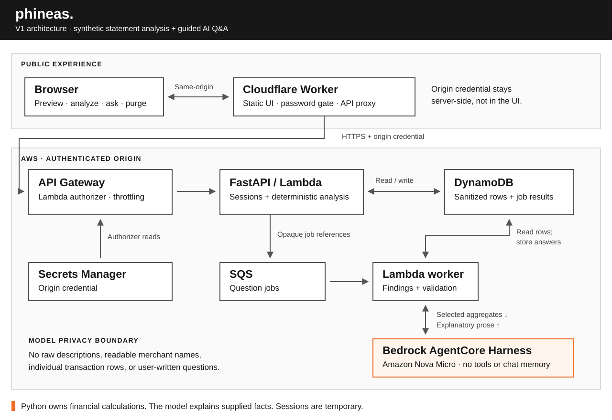

# Phineas

A privacy-first financial-analysis partner: understand statement activity and
spot charges worth reviewing, without sending transaction descriptions to an LLM.

**[Try the live demo →](https://phineas-finance.hochoy.dev)**

Preview a synthetic statement, then enter the demo password supplied by your
inviter to run analysis and explore the guided questions. No sign-up, uploads,
or bank connection. Access stays in the tab's memory and expires after four hours.

## What V1 does

- Finds possible monthly subscriptions and their estimated annualized cost.
- Summarizes fees and interest, flags possible duplicate purchases, and shows
  money moving in and out. Cash movement is not a spending total.
- Offers six guided question buttons with AI-generated explanations and
  supporting findings. V1 is not free-form chat and does not interpret paraphrases.
- Provides short-lived sessions and an explicit **End session & purge** action.

The samples contain 50 and 10 transactions. Findings are candidates to review,
not confirmed billing errors or financial advice.

## How it works

Python calculates the financial facts. **Amazon Nova Micro explains selected
facts; it does not perform the authoritative arithmetic.** Questions run through
an SQS-backed worker, so the browser can poll for an answer without holding an
inference request open. Both REST handlers and workers reuse the application logic.

Built with Python, FastAPI, Pydantic, Docker, Terraform, DynamoDB, SQS, Amazon
Bedrock AgentCore Harness, and Cloudflare Workers. This portfolio project focuses
on explicit data boundaries and practical AI deployment—not just model output.

## Deliberate boundaries

- **Synthetic-only public demo.** The public record preview shows made-up source
  descriptions. Readable merchant names, raw descriptions, and transaction rows
  do not enter the narrative model's context; only selected aggregate facts do.
- **Temporary, not a financial archive.** Sessions expire after 30 minutes idle
  or four hours total. Purge deletes stored session records; DynamoDB TTL handles
  abandoned data eventually. Refresh loses tab access, not server records.
- **Bounded access.** A server-held credential protects the AWS origin; edge
  password checks restrict analysis and AI use to invited reviewers. Edge
  limits, gateway throttles, and question quotas reduce abuse. These are not a
  hard spending cap. Citations and validation reduce—not eliminate—model errors.

## What's next

| Release | Scope |
| --- | --- |
| V1 | Synthetic statement analysis and guided AI Q&A; public demo available. |
| V2 · planned | Evaluate a category classifier such as Laya; larger realistic synthetic datasets; category totals and month-over-month trends after a privacy/storage review. |
| V3 · planned | Subscription price increases and other anomaly-driven nudges. Background monitoring or notifications would need a separate retention/consent design. |

MCP is not on the committed roadmap. Real bank integrations, long-term records,
payments, and unrestricted financial advice are outside the current product.

## Further reading

- [Architecture and trust boundaries](docs/architecture.md)
- [Analysis rules and limitations](docs/analysis-policy.md)
- [Release roadmap](docs/roadmap.md)
- [Run the web interface locally](web/README.md)
- [Public deployment and operator controls](docs/coaching/cloudflare-deployment.md)
- [Shared demo password setup](docs/coaching/demo-password.md)
