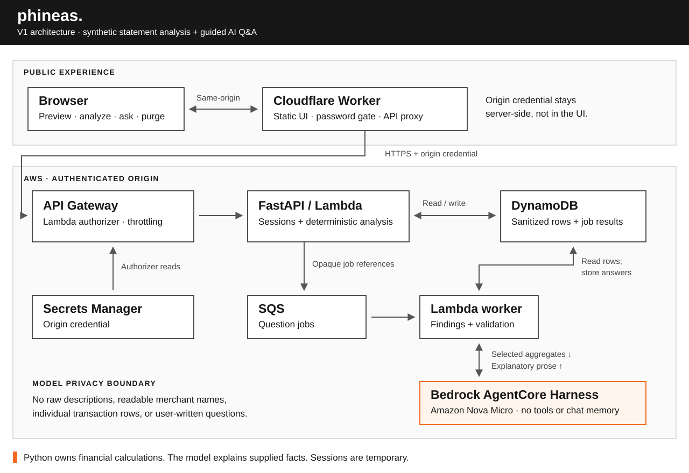

# V1 architecture and trust boundaries

[Back to the project overview](../README.md)

## Browser and edge

Cloudflare Workers serves the existing HTML/CSS/JavaScript interface and proxies
an explicit `/api` route allowlist. The convenience domain points visitors to the
public Worker. Guided buttons expose the six analytical intents; there is no
free-text composer, model conversation memory, login, or upload in V1.

The Worker applies request/body limits, per-IP rate limits, same-origin response
headers, and safe error handling. It rebuilds outbound headers with the server-held
origin token. The browser never receives that token or AWS credentials. API
Gateway checks it through a dedicated Lambda authorizer before invoking FastAPI.
Knowing the AWS origin URL does not provide anonymous application access.

Separately, a shared reviewer password gates analysis and AI requests at the
Worker, before AWS forwarding. Successful unlock returns a signed four-hour
bearer token kept only in tab memory; password checks are rate-limited. Preview
remains public, and purge still works with a valid session capability after
reviewer access expires. This is an invitation gate, not proof of recruiter
identity. See [password setup and rotation](coaching/demo-password.md).

The origin token is stored in Secrets Manager and Cloudflare's secret binding, not
Terraform state or source. It is a rotatable bearer credential, not user identity.
The authorizer caches a successful secret read for up to 60 seconds. Detailed
setup and revocation limitations: [origin authentication](coaching/public-origin-auth.md).

## Application, storage, and analysis

FastAPI creates a session from an allowlisted bundled synthetic sample. Ingestion
parses and sanitizes it in memory; short-lived DynamoDB records contain sanitized
transaction data and job state/results, not readable merchant descriptions or raw
statement contents. The public sample preview is deliberately different: it
displays only the fixed, made-up source fixtures, never private/session records.

Python owns decimal arithmetic, cash movement, recurrence, duplicate detection,
fees, and interest. API handlers and workers reuse the same analysis functions.
Eligibility policies retain payments/refunds and other valid rows while excluding
irrelevant kinds from specific checks. See [analysis policy](analysis-policy.md).

## Questions and model boundary

The API classifies the exact supported question phrases before reserving a job.
It stores the approved intent and queues only opaque session/job references and
schema metadata—no user question text, financial amounts, or statement rows.
The worker claims a job, reads sanitized transactions, calculates findings, and
sends only topic-relevant aggregate fact cards to AgentCore Harness / Nova Micro.
There are no model tool calls in this narrative path. Raw user questions, readable
merchant names, individual transaction rows, and prior chat are not model inputs.

The response must satisfy JSON, citation, numeric, and selected lexical checks.
These checks are not semantic entailment proof. The worker stores the accepted
answer; the browser polls the API and can expand deterministic supporting facts.
Empty findings/unsupported intents do not invoke the model. Retry limits, leases,
idempotency, expiration, and purge fencing handle asynchronous delivery.

## Session lifecycle and operations

Idle expiry is 30 minutes and absolute expiry is four hours. Application checks
make expired records inaccessible immediately; TTL is eventual cleanup, not a
deletion deadline. Explicit purge fences further access/writes and deletes the
session partition. No recovery page, accounts, or backups are provided. Browser
refresh loses the tab's capability but does not purge server records.

The hosted demo admits at most 10 new question jobs per session and 25 per UTC
day globally. Edge limits and gateway throttling are best-effort protections,
not hard monetary caps. Terminal-job and DLQ alarms notify an SNS email subscriber.
Application logs exclude capability IDs, request bodies, credentials, and financial
data; platform providers still process operational network metadata.

AWS infrastructure is Terraform-managed; application/worker images are pinned by
digest. Cloudflare deployment uses Wrangler. Image scans, private API tests, origin
authentication tests, and public browser/mobile tests are separate evidence—not
interchangeable assurances. See [deployment controls](coaching/cloudflare-deployment.md).
